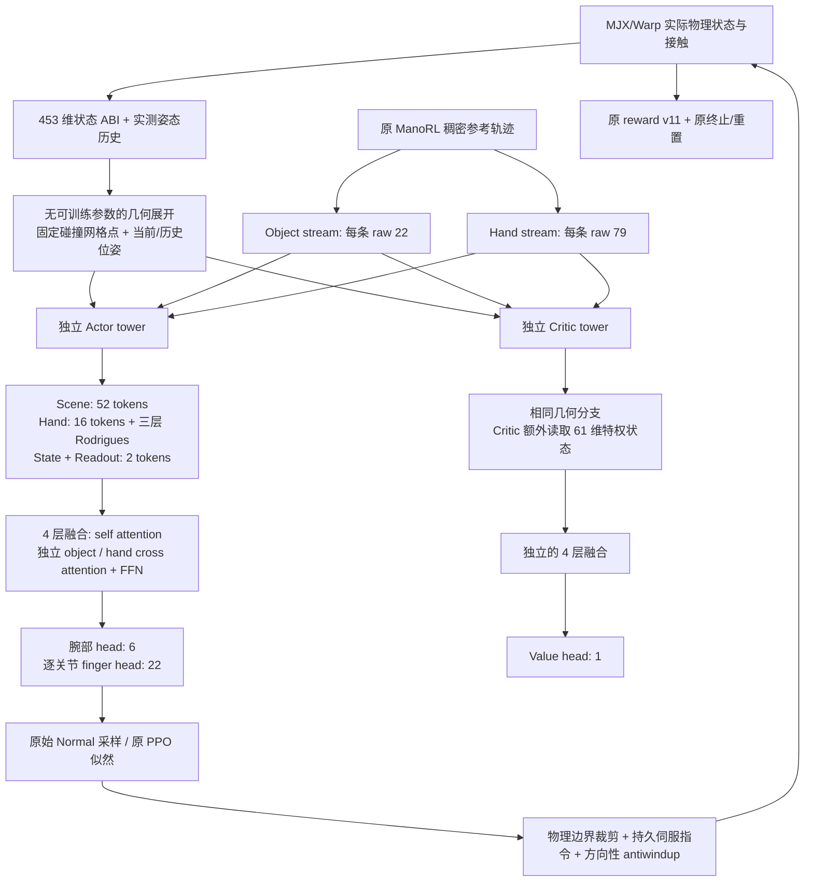

# VoxMani 453 + ManoRL v11

该版本在 ManoRL `0f8f441` 上整体替换策略网络，网络结构依据
VoxMani `16a80fc6615c3f82194acd34e45b98d459359325`，
提交时间为北京时间 2026-10-10 20:26:00，分支为
`case/auton-policy/waypoint-generalization`。版本名为 `v5.voxmani453`。

## 网络与数据流

453 是当前物理状态 ABI 的维度。物体和手的参考目标通过独立的结构化输入传递，
因此不能把“453”理解为网络接收的全部信息。旧 v5 的 1342 维向量不会被截断、
投影或直接送入新网络。



- 当前侧为 70 tokens，每个 token 128 维；注意力 4 heads，FFN 512 维。
- 场景的 52 tokens：当前物体 16、桌面 16、五个历史姿态各 4。
- 手部为 16 个骨骼表面 tokens，融合三层 Rodrigues 传播的 64 维 link features。
- Actor 的低维分支为 314 维；Critic 为 375 维。
- 每层分别归一化 object/hand cross attention，带 mask、presence gate 和 NULL token。
- Actor/Critic 的可训练参数完全独立，只共享没有可训练参数的几何展开。
- Critic 最后一层没有下游消费者的 theta 投影被移除；三层 link 传播全部保留。
  这样每个注册参数都有实际消费者，可满足既有严格 Adam 恢复检查。

## 453 维字段

字段顺序以 `sim/manorl/autonomy_contracts.py` 为唯一来源。

| 字段 | 维数 | 来源 |
|---|---:|---|
| obj_part_pose | 7 | 实际物体位置与 wxyz 四元数 |
| obj_past_pose | 35 | 1、2、4、8、16 个控制步前的实测姿态 |
| obj_past_pad | 5 | 每个世界独立的历史不足标志 |
| hand_body_pose | 112 | 16 个实际手骨骼位姿 |
| finger_q / finger_qd | 22 + 22 | 实际关节角与速度 |
| bone_contact | 48 | 手骨骼接触反力 |
| obj_force_obs | 60 | 重力、16 骨骼力、手力矩、其他物体力及力矩 |
| wrist_twist / obj_twist | 6 + 6 | 实际速度和角速度 |
| mass_obs | 1 | 当前单物体固定质量相对自身参考质量的 log 比值，等于 0 |
| prev_action | 28 | 上一物理步实际执行的裁剪动作 |
| priv_13 | 13 | 稠密参考误差与时间，仅 Critic |
| support_ratio_obs / contact_bone_count_obs | 1 + 1 | 实际净支撑与接触骨骼比例 |
| servo_error | 28 | 持久指令与实测关节位置之差 |
| critic_keypoint_error | 48 | 16 骨骼参考位置误差，仅 Critic |
| terminal_hand_goal | 10 | 最终参考掌位移、相对旋转与终点标志 |

## 适配当前 v5 + v11 的约定

1. **物理、控制、奖励**：维持 28 个动作，120 Hz 控制、四个物理子步，
   持久伺服目标、方向性 antiwindup、接触归约、reward v11 和原重置/终止。
   PPO 使用原始 Normal 样本；只在物理动作边界裁剪。
2. **参考目标**：保留 ManoRL 稠密参考任务。目标选取当前、未来 6/12/24 帧和终点；
   靠近终点时去重并缩短 mask。没有引入上游 waypoint MDP 或改变 v11 奖励。
3. **目标快照**：两路目标存在 PPO `states` 的 547 个序列化浮点数中，
   与 453 维 `observations` 分开。采样时、terminal-next bootstrap 和 teacher anchor
   均使用该步目标快照，更新时不读取环境已经前进的参考索引。
   `frame_id` 仅用于来源记录，不进入网络编码。
4. **坐标和网格**：统一使用 ManoRL 世界坐标；四元数在 ABI 边界转为 wxyz。
   固定表面点和骨架从已锁定的碰撞资产生成；桌面来自编译场景的真实 floor plane。
5. **终端手目标**：使用 ManoRL 最终参考掌位姿，保持 v11 结束语义。
   相对旋转为 `inverse(current) * final`，rot6 按前两列分别展开。
   上游终端分支使用 `final * inverse(current)` 并按矩阵行展开，因此数值语义并非完全相同。
6. **质量**：当前运行时没有质量随机化，`mass_obs = log(m / m_ref) = 0`；
   其余力通道均使用真实质量和物体尺度归一化。若以后引入跨质量训练，
   必须增加固定训练集质量参考并更新契约，不能直接把该字段继续置零。
7. **检查点**：新模型有独立 ABI/架构标识。旧 v5 权重不可直接恢复到新网络。
   支持新模型自己的严格 model/Adam/RNG 恢复和冻结评估。

## 运行

交付目录包含已物化碰撞资产以及
`data/cube2_all_v295_f120_pre180_post180` 真实参考包。训练不需要读取外部 NAS。
Python 3.11，依赖见 `pyproject.toml`。220 已验证的环境是
`/home/cty/miniconda3/envs/contact-conditioned-autonomy`；
本地 CPU 验证环境为 `/tmp/voxmani453-validation-env`。

在项目根目录运行完整 GPU 执行验证：

```bash
/home/cty/miniconda3/envs/contact-conditioned-autonomy/bin/python \
  tools/run_voxmani453_experiment.py \
  --output outputs/voxmani453_gpu_run001 \
  --wait-seconds 3600
```

脚本仅选择没有 CUDA 计算进程且显存使用低于 512 MiB 的 GPU。
它记录物理 GPU UUID，并通过 `CUDA_VISIBLE_DEVICES` 限制子进程。
如果没有空闲 GPU，则有界等待；不会结束其他用户的进程。
依次验证真实环境部分重置、8 次 PPO 更新、严格续训至第 10 次更新、自然终止冻结评估。
输出状态为 `status.json`；最终证据为 `validation.json`、两次训练的检查点/指标和
`evaluation.json` / `evaluation.npz`。只有验证全部通过才写入 `stage=complete`。

手动 CPU 冒烟训练：

```bash
/tmp/voxmani453-validation-env/bin/python tools/train_manorl_autonomy.py train \
  --policy-version v5.voxmani453 --reward-version v11 \
  --package data/cube2_all_v295_f120_pre180_post180 --identity cube2_02_2833 \
  --device cpu --num-envs 2 --no-persistentworkspace \
  --updates 3 --rollouts 8 --learning-epochs 1 --mini-batches 2 \
  --learning-rate 1e-5 --teacher-anchor-beta 0.2 --teacher-anchor-passes 1 \
  --checkpoint outputs/new_cpu_run/policy.pt --checkpoint-interval 1 --no-wandb
```

续训时添加 `--resume-checkpoint <source.pt>`，`--updates` 表示累计目标更新数；
其他物理、PPO 和 teacher 参数必须一致，`--checkpoint` 使用新的输出路径。
冻结评估入口为同一 CLI 的 `evaluate` 子命令。

## 已验证的本地证据（2026-10-12）

- 43 项针对性测试通过：453 ABI、力符号、历史、目标快照/掩码、Actor 特权隔离、
  双塔独立参数、PPO 实际参数更新/完整 Adam 状态、v5/v11 和 teacher 回归。
- CPU MJX/Warp：B=2，3 次训练更新，再严格恢复至第 4 次，共 64 条物理交互。
  Adam 包含 645 个参数状态；恢复后 637 个模型浮点 tensors 改变。
- 冻结评估 228 步，所有记录 finite/valid；第 228 步按原偏离规则终止，
  return 为 6.87830363214016。该结果不代表抓取成功或策略收敛。
- 真实物理环境的部分重置保留另一世界的位置、指令、历史和目标快照，
  `prepare_action` 不增加历史计数。
- 证据见 `outputs/voxmani453_cpu_resume_v3/validation.json`。
- 扩展旧测试发现 7 failures / 16 setup errors，均已在未修改基线 `0f8f441`
  复现：旧控制测试 patch 已移除的符号，遥测 fixture 缺少现行字段，
  CLI resume fixture 使用没有 identity 的对象。没有将这些检查宣称为通过。

GPU 实验状态必须以远端实际 `status.json`、进程和输出为准；
本地 CPU 验证不构成 GPU 实验已完成的证据。
